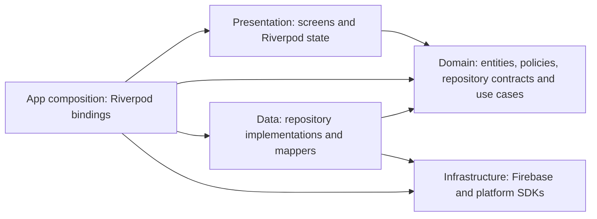

# SplitEx clean architecture migration plan

Prepared 2026-10-26 from the current source at commit `b56da02`.

Ownership revised 2026-10-26: four main modules (Personal, Group, Room, Project/Track), with common Settings and Notifications. This ownership replaces the earlier proposal for separate top-level accounts, loans, SMS, identity and insights features.

Layer structure revised 2026-10-26: use three layers per module/capability: `domain/`, `data/`, and `presentation/`. Business use cases live in `domain/use_cases/`; there is no separate `application/` layer. `dependencies.dart` supports Riverpod wiring and is not an architectural layer.

This is the implementation roadmap. Phase 0, the Personal accounts/transfers pilot, and an initial Personal transaction boundary were implemented on 2026-10-26; see `docs/CLEAN_ARCHITECTURE_STATUS.md` for baseline and validation evidence. The remaining Personal workflows and later modules remain planned. Device behavior and real Firebase rules/transactions still require emulator or device validation in their applicable stages.

## 1. Decision and purpose

Evolve SplitEx into a modular Flutter application with four main business modules: Personal, Group, Room, and Project/Track. Keep Settings and Notifications as common capabilities. Retain Riverpod for state management and dependency injection, go_router for navigation, Firebase for persistence/authentication, and the current design system.

The concrete goals are to test financial rules without Firebase or widget setup, change persistence without changing screens, make dependencies visible, and confine changes to the feature that owns the behavior. Application size alone does not justify every possible clean architecture abstraction.

Use a domain layer for entities, financial rules, repository contracts and use cases. Add use cases under `domain/use_cases/` for meaningful business operations and workflows. Simple reads can use repository contracts directly from providers. Avoid a wrapper class for every CRUD method, a generic base repository, a second dependency injection framework, or a state management replacement.

Flutter's [architecture recommendations](https://docs.flutter.dev/app-architecture/recommendations) support repository abstractions, dependency injection, and separated UI responsibilities; they make a use-case layer conditional on complexity. This plan adapts those principles to the existing Riverpod application.

The three-folder layout is a Flutter convention chosen for this project, not a globally mandated directory standard. The essential rule is that source dependencies point inward toward business rules, as described in the [original Clean Architecture article](https://blog.cleancoder.com/uncle-bob/2012/08/13/the-clean-architecture.html). Use cases remain independent of Firebase and UI details regardless of folder naming.

## 2. Evidence behind the decision

The working tree was clean before this document was added. The repository contains 159 Dart files under `lib/`, with 43,587 lines including blanks, and 12 Dart test files directly under `test/`.

| Observation | Evidence | Architectural consequence |
| --- | --- | --- |
| Existing separation is a useful starting point | `screens/`, `providers/`, `services/`, `models/` | Preserve behavior and evolve one feature at a time. |
| Persistence types escape into application models | 14 files in `lib/models/` directly import Firestore or Firebase Auth | Extract pure entities and move Timestamp, FieldValue, document decoding, and map serialization into data adapters. |
| UI knows persistence or authentication implementation details | 8 files in `lib/screens/` directly import Firestore or Firebase Auth | Replace Firestore update maps and direct Firebase session access with typed commands and session state. |
| Important services construct concrete dependencies | `LoanService`, `RecurringProcessor`, `ExpenseService` | Inject repositories and collaborators through constructors and Riverpod wiring. |
| Business calculations and side effects share classes | `LoanService` calculates payments, writes payment logs, creates personal transactions, and updates recurring entries | Separate pure policies, workflow coordination, and atomic persistence operations. |
| Some useful logic already exists independently of widgets | `SplitCalculator`, balance calculations, monthly review and payment calendar builders | Preserve and test these; remove their transitive dependence on persistence-bound models. |
| Some screens combine many responsibilities | Personal expense tab: 1,455 lines; room detail: 1,362; loan list: 1,314 | Extract business logic first, then cohesive UI sections. File length is a signal, not a completion metric. |
| Tests provide a starting safety net, with gaps | Accounts, SMS, calendar, finance, debt, widget tests; `widget_test.dart` only asserts true | Keep meaningful cases and add missing high-risk characterization tests. The named smoke test does not establish app startup. |
| Existing platform behavior must survive | Bank SMS MethodChannel, Android Kotlin code, expenses widget, FCM, local notifications | Treat native protocols and lifecycle ownership as compatibility contracts. |

These counts are import/source observations, not a complete coupling or coverage measurement. Indirect dependencies also matter.

## 3. Target structure and dependency rules

### Module ownership

| Owner | Responsibilities |
| --- | --- |
| Personal | Accounts/wallets, transfers, transactions, budgets, personal debts, recurring entries, savings goals, loans/EMIs, bank SMS, merchant rules, personal dashboard/reports, payment calendar and monthly review. |
| Group | Group creation/joining/membership, group expenses, group balances/settlements, group dashboard and reports. |
| Room | Room creation/joining/membership, room expenses, bills, room balances/settlements, room dashboard, activity and analytics. |
| Project/Track | Projects, tracking, project budgets/expenses/debts, vendors, project dashboard and reports. Use `project/` as the code directory for the Project/Track module. |
| Common Settings | Theme/palette/appearance, home-screen widget configuration and platform integration, app preferences, notification preference UI, profile/account settings, updates, export/settings tools. Module-specific rules and data operations stay with their business owner. |
| Common Notifications | Notification delivery, FCM registration, local notifications, notification feed, unread state and notification contracts. |
| App shell | Bootstrap, authentication entry flow, session lifecycle, navigation, module tabs and composition of common capabilities with module contracts. |
| Shared UI and core | Reusable UI components and small technical/pure foundations. These are support code, not additional business modules. |

Loans, SMS, accounts and reports are subfeatures inside their owning module. They do not become additional top-level modules. Notification settings UI belongs to Settings; notification delivery/preferences contracts belong to Notifications.

Here, "home-screen widget" means the Android/native expenses widget. Ordinary Flutter widgets remain in the owning module's presentation layer, or in shared presentation when reusable. Theme preferences and theme construction belong to Settings; generic UI components can consume Flutter's ambient Theme without depending on the Settings screen.

### Directory layout

Use module-first organization, then the three architectural layers within each module. Within domain and data, group by responsibility and use subfeature folders when those directories grow. Presentation can group screens, widgets and state by subfeature. Avoid repeating a complete layer hierarchy for every small screen.

| Layer | Responsibilities | Dependencies |
| --- | --- | --- |
| Domain | Entities/value objects, repository contracts, financial policies and business use cases | Dart SDK, suitable pure Dart libraries, and allowed inner contracts; no Flutter, Riverpod, Firebase or platform SDKs |
| Data | Repository implementations, storage/network models and mapping, remote/local/native data sources, atomic persistence | Domain and relevant infrastructure SDKs |
| Presentation | Screens, Flutter widgets, Riverpod providers/controllers, display formatting and loading/error state | Domain contracts/use cases, Flutter/Riverpod and dependency declarations; no concrete data implementations |

`dependencies.dart` declares contract-based Riverpod dependencies. App composition supplies concrete implementations. Neither file creates a fourth business layer.

```text
lib/
  main.dart
  app/
    app.dart
    bootstrap/
    routing/
    lifecycle/
    authentication/              # shared sign-in/registration entry flow
    composition/                 # Riverpod bindings and cross-module adapters
  core/
    domain/                      # session values, clock, failures, proven shared policies
    infrastructure/              # configured Firebase clients, telemetry
  shared/
    presentation/
      design_system/
      widgets/                   # reusable Flutter components
  modules/
    personal/
      domain/
        entities/                # accounts, transactions, budgets, debts, savings, loans
        repositories/            # abstract account/transaction/loan/import contracts
        policies/
          accounts/              # balance and transfer rules
          loans/                 # EMI and amortization calculations
          bank_sms/              # pure parsing and matching rules
          recurring/             # due-date rules
          reports/               # calendar and monthly-review calculations
        use_cases/
          accounts/              # save transfer, archive account
          transactions/
          budgets/
          debts/
          recurring/
          savings/
          loans/                 # payment + expense + recurring workflows
          bank_sms/              # review/import workflows
          merchant_rules/
          reports/
      data/
        repositories/            # concrete implementations, grouped by subfeature as needed
        mappers/                 # Firestore/platform values <-> domain values
        models/                  # storage/transport models where useful
        datasources/             # separate only when useful
          remote/
          local/
          native/                # SMS MethodChannel adapter
      presentation/
        dashboard/
        accounts/                # screens, widgets, providers/controllers as needed
        transactions/
        budgets/
        debts/
        recurring/
        savings/
        loans/
        bank_sms/                # SMS settings and review screens
        merchant_rules/
        reports/
      dependencies.dart          # contract-based Riverpod dependency declarations
    group/
      domain/                    # entities/, repositories/, policies/, use_cases/
      data/
      presentation/              # membership, expenses, settlements, dashboard/reports
      dependencies.dart
    room/
      domain/                    # entities/, repositories/, policies/, use_cases/
      data/
      presentation/              # membership, expenses, bills, settlements, analytics
      dependencies.dart
    project/
      domain/                    # entities/, repositories/, policies/, use_cases/
      data/
      presentation/              # tracking, expenses, debts, dashboard/reports
      dependencies.dart
  common/
    settings/
      domain/                    # entities/, repositories/, use_cases/ for preferences/widget
      data/                      # preferences storage and home-widget native adapter
      presentation/
        preferences/
        appearance/              # theme/palette selection and ThemeData construction
        home_widget/             # expenses widget settings
        profile/
        notifications/           # notification preference controls
      dependencies.dart
    notifications/
      domain/                    # entities/, repositories/, use_cases/ for feed/delivery
      data/                      # Firestore/FCM/local notification adapters
      presentation/              # common feed, unread badge, notification UI
      dependencies.dart

test/
  modules/
    personal/                    # domain/data/presentation tests by subfeature
    group/
    room/
    project/
  common/
    settings/
    notifications/
  app/
  architecture/
  support/

integration_test/
```

Create directories when their implementation moves; the tree describes ownership, not a requirement for empty folders or a class for each operation. Domain contains entities/repositories/policies/use cases; data contains concrete repositories/mappers/models/data sources; presentation contains screens/widgets/providers/controllers. Subfeatures in Personal collaborate through domain contracts; for example, loan payment use cases consume Personal's transaction and recurring contracts.

Storage/transport models do not have to extend domain entities. Use explicit mapping when it makes the boundary clearer; do not create a duplicate model when a mapper alone is sufficient.

Personal, Group, Room and Project each own their dashboard/reports and activity semantics. A home page that combines module summaries belongs to the app shell and consumes exported read projections. There is no separate Insights business module.

Settings owns the home-widget preferences, synchronization workflow, native bridge and rendering integration. Financial totals remain calculated by the owning business module. A Settings domain port requests a pure widget snapshot; an adapter wired in app composition obtains the appropriate module projections and supplies that snapshot. Settings does not query another module's collections or calculate its balances. Keep the existing widget scope/payload during migration rather than expanding it to all modules.

If a settings entry opens SMS or loan preferences, route to the screen owned by Personal. Global account/profile preference UI can live in Settings while authentication/session operations use common contracts. App bootstrap/session coordination activates and disposes SMS, widget and notification services through their owners' interfaces.

### Current code to planned owner

| Current code | Destination owner |
| --- | --- |
| Personal account/transaction models, providers, services and personal screens | `modules/personal/`: pure entities/contracts/policies/use cases in domain; persistence in data; screens/state in presentation |
| Loan models/services/providers and `screens/loans/` | Personal domain entities/contracts, `domain/policies/loans/`, `domain/use_cases/loans/`, data adapters and `presentation/loans/` |
| Bank SMS parser/repository/service and `screens/settings/bank_sms_settings_screen.dart` | Personal `domain/policies/bank_sms/`, `domain/use_cases/bank_sms/`, data repositories/native datasource and `presentation/bank_sms/` |
| Payment calendar and monthly money review models/providers/screens | Personal domain projections, `domain/policies/reports/`, use cases where needed, and `presentation/reports/` |
| Group code | `modules/group/` |
| Room, room expense, bill and room settlement code | `modules/room/` |
| Project models/services/providers and `screens/projects/` | `modules/project/` |
| Theme preferences, palette handling and `config/theme.dart` | `common/settings/`, including `presentation/appearance/` |
| Expenses widget settings, snapshot contract, sync and platform adapter | `common/settings/`, with business-summary input wired through app composition |
| Notification delivery/feed code, FCM and local notification adapters | `common/notifications/` |
| Notification preference screen | `common/settings/presentation/notifications/`, using Notifications contracts |
| Authentication entry screens, router, bootstrap and session coordination | `app/`, using pure session contracts from core |
| Shared design-system components and generic UI widgets | `shared/presentation/`; feature-specific widgets move to their owner |
| Existing aggregate dashboard/home code | Owner-specific pieces move to the relevant module; tab shell and cross-module summary composition stay in `app/` |

Native Kotlin/Swift files stay in their platform-required directories. Their logical owner follows the table: SMS belongs to Personal, home-screen widget integration to Settings. Preserve channel names, payloads and entry points during Dart restructuring.

Import direction:



- Domain uses pure Dart. Suitable pure Dart libraries are allowed; domain imports no Flutter, Riverpod, Firebase, platform plugins, data or presentation code. Check transitive imports as well as direct ones.
- Use cases live in `domain/use_cases/` and depend on pure entities, policies and repository contracts, never concrete repository implementations or widgets. They coordinate business operations while data implementations own persistence details and atomic writes.
- Presentation owns loading/error/display state and UI formatting. Widgets pass typed inputs through controllers/providers to use cases or simple repository-contract operations. Riverpod providers can remain small selectors without introducing a controller for each one.
- Data owns schema knowledge, queries, mapping, SDK exceptions, and transaction/batch execution. Add separate datasource classes only when they remove real duplication or support multiple sources.
- Module/common `dependencies.dart` files declare Riverpod dependencies using domain contracts and use cases, without importing concrete data implementations or screens. App composition constructs the implementations and supplies overrides. State reads those dependency declarations, so it does not import app composition. Missing required bindings should fail explicitly rather than silently construct a production singleton.
- Firebase Auth `User` becomes a pure session value. Pass an explicit user ID to account-scoped operations; reset scoped streams and listeners on sign-out or account switch.
- Keep Personal, Group, Room and Project independent: one business module must not import another business module's implementation, state or screens. App composition combines their exported contracts/read projections where necessary. Subfeatures inside a module can collaborate through that module's domain contracts and use cases.
- Business modules can consume the common notification contract. Common Settings and Notifications must not import business module implementations; supply module-specific data and actions through ports wired by the app. Notification navigation emits an intent resolved by app routing. Preferences shared with Notifications have one authoritative repository/contract rather than competing stores.
- Reusable Flutter components stay in shared presentation or their owning module. Appearance/theme construction and home-widget integration stay under Settings. Shared widgets use ambient Theme/tokens without importing Settings screens or providers; app composition applies the selected theme.
- Keep a small shared kernel. Define a clock/time source when extracting time-dependent rules. A future Money type needs an explicit rounding decision and separate validation; preserve current amounts, rounding, signs, and schema during structural migration.
- Translate SDK failures into a small typed application failure vocabulary at the boundary. Preserve loading and errors in state; avoid turning failed financial reads into a displayed zero.

## 4. Migration sequence

Each numbered stage can contain several small commits. Completion depends on the checks, not a fixed file count or calendar estimate.

| Stage | Concrete work | Completion gate |
| --- | --- | --- |
| 0. Baseline and module map | Record analyzer/tests/build results, existing failures, dependencies, routes, schema/native contracts, and device smoke checks. Assign existing files to the four business modules, common Settings/Notifications, app or shared support. Record decisions and targeted characterization tests. | Reproducible starting point and confirmed ownership. |
| 1. Personal: accounts/transfers pilot | Extract pure account/transfer entities, balance inputs and policies under `modules/personal/`; implement compatible Firestore adapters and contract-based Riverpod wiring; reconnect the existing UI. | Accounts work end to end within Personal, tests remain, domain imports are clean, no schema or visible behavior changes. |
| 2. Personal: finance foundation | Migrate transactions and typed commands, budgets, debts, recurring entries, merchant rules and savings into Personal's layers. | All creation sources use a consistent Personal transaction contract; repayment, rounding and recurring behavior are preserved. |
| 3. Personal: bank SMS | Separate native queue/permission adapter, parser/rules, import workflow, persistence and review state within Personal. | Consent, isolation, matching, review and duplicate prevention are preserved, including native device checks. |
| 4. Personal: loans and reports | Extract EMI/amortization/date policies and payment commit contracts; migrate loan/recurring workflows, Personal dashboard, calendar, monthly review and reports. | Payments, retries, closure and recurring semantics are tested; Personal projections remain read-only. |
| 5. Room | Migrate membership, expenses, bills, balances, settlements, activity and Room dashboard/analytics. | Conservation/rounding, month filters, membership and settlement state are validated. |
| 6. Group | Migrate membership, expenses, balances, settlements, dashboard and reports within Group. Reuse pure split policies only when semantics match Room. | Group behavior is preserved and Group remains independent of Room. |
| 7. Project/Track | Migrate project tracking, budgets, expenses, debts, vendors, dashboard and reports. | Project totals, tracking and reporting behavior are preserved. |
| 8. Common Settings and Notifications | Complete preference/theme/profile settings, Settings-owned home-widget configuration/sync/native adapter, notification preference UI and common feed/delivery. Wire module projection ports through the app shell. | Themes/settings persist, widget payload/rendering remains compatible, notifications and account switching work without duplicate listeners. |
| 9. App integration and enforcement | Finish shell navigation/session/auth integration, remove legacy facades, tighten boundary checks and update documentation. | Four business modules and common capabilities follow the rules; required tests/build/device checks pass. |

Session contracts, common capability interfaces, injection seams and navigation adapters are introduced when the pilot needs them. Do not postpone essential authentication lifecycle fixes until stage 9. Settings-owned widget and common notification consumers touched by an earlier stage must be adapted and validated in that stage; stage 8 finishes their migration. This is migration sequencing, not a delay in assigning ownership.

### Phase 0: exact first steps

1. Work on a dedicated migration branch and record the starting commit and working tree. Preserve unrelated local changes if present.
2. Establish the SDK/toolchain. `flutter` and `dart` were absent from this shell's PATH, but `android/local.properties` points to an existing `C:\sdk\flutter_new` installation. Confirm its version before using it. The declared `^3.11.5` constraint is for Dart, not a Flutter SDK version.
3. Run `flutter analyze` and `flutter test` with the project's SDK. Record failures and warnings before edits; fix blockers separately. Build the currently supported release target and check which other platforms actually work. Platform folders do not prove platform support.
4. Capture the current collection/field names, optional/missing-field defaults, document IDs, month filters, query ordering/metadata options, rules and native channel/widget payloads. Read `FIREBASE_COLLECTIONS.md`, `BANK_SMS_RECORDING.md`, `PERSONAL_FINANCE_FEATURES.md`, and the code together.
5. Build the four-module/common dependency map and identify all callers of Personal accounts, transfers and assigned transactions, including SMS, transaction forms and the account picker. Map themes/home-widget settings to common Settings, notification delivery to common Notifications, and reports to their business owners. Distinguish UI formatting from financial policy.
6. Add missing characterization cases around high-risk loan/split/recurring behavior before those features migrate. Mark known defects explicitly; an intentional behavior fix should be a separately reviewed change.
7. Record short decisions covering module/subfeature ownership, import direction, Riverpod wiring, model mapping, error/time handling, and atomic workflows. Add boundary checks incrementally as subfeatures migrate.

### Phase 1: exact pilot procedure

The pilot is the accounts/transfers subfeature of Personal. Under `lib/modules/personal/`, its destinations are:

```text
domain/
  entities/accounts/             # PersonalAccount, PersonalTransfer, pure balance inputs
  repositories/                  # account/transfer/balance-input contracts
  policies/accounts/             # balance calculation and transfer validation
  use_cases/accounts/            # SaveTransfer, ArchiveAccount where useful
data/
  repositories/                  # Firestore account/transfer implementations
  mappers/accounts/              # existing schema <-> pure values
presentation/
  accounts/                      # existing screens, picker, forms and Riverpod state
dependencies.dart                # contract-based dependency declarations
```

Pure transaction-balance projections can move under Personal's transaction entities as that boundary is established. Tests mirror the domain/data/presentation responsibilities; use-case tests belong under domain.

Start from:

- `lib/models/personal_account_model.dart`
- `lib/services/personal_account_service.dart`
- `lib/providers/personal_account_provider.dart`
- `lib/screens/personal/personal_accounts_screen.dart`
- `lib/widgets/personal_account_picker.dart`
- `test/personal_accounts_test.dart`
- `test/personal_accounts_screen_test.dart`

Procedure:

1. Preserve tests for paise arithmetic, opening/card balances, edits/deletes/reassignment, account archival, invalid transfers and user isolation.
2. Extract `PersonalAccount`, `PersonalTransfer` and the balance policy into Personal's pure domain. Supply a narrow pure transaction-balance input so the migrated subfeature does not import the legacy Firebase-bound transaction model.
3. Define the required account, transfer and balance-input repository methods using typed values. Preserve the existing account/transaction/transfer stream behavior and ordering.
4. Move Timestamp/map conversion and Firestore queries/writes into data implementations. Keep `users/{uid}/personal_accounts`, `personal_transfers`, and the assigned-transaction query compatible.
5. Separate pure validation from persistence checks. The active-account/existence validation for transfers must still execute inside the Firestore transaction, because pure validation cannot protect against concurrent archival.
6. Declare contract-based dependencies in Personal and inject Firebase/repository implementations from app composition. Add use cases under `domain/use_cases/accounts/` and presentation controllers/state where they remove write orchestration from widgets. Keep the account picker under Personal presentation; adapt existing callers without a redesign.
7. Use narrow temporary legacy adapters for still-unmigrated callers. Each adapter has an owner/removal stage; it must not leak SDK-bound models into the new domain. Avoid duplicate competing providers or implementations.
8. Run the relevant tests and analyzer, then the full suite at pilot completion. Inspect the UI and check account switching, error/loading state and existing-record compatibility.
9. Record the final pilot structure as the pattern for later subfeatures/modules. Delete its obsolete implementation once all its consumers have moved.

## 5. Financial and platform constraints

- Preserve Firestore document IDs and deduplication keys. Regular EMI payment and personal-expense records already share a transaction with stable IDs in `_saveEmiWithExpense`; keep that guarantee.
- Loan partial payments and foreclosure currently take different, multi-step write paths. Characterize them separately. Any stronger guarantees or changed duplicate rules need explicit tests and a distinct behavior change.
- Moving a workflow into a use-case class does not make it atomic. Define a domain-level commit operation/port when multiple records must be committed together, with a Firestore implementation that owns the transaction. Do not replace one transaction with independent repository calls.
- Preserve bank SMS receipt + transaction/transfer + optional merchant-rule atomicity and account isolation. Keep native queue acknowledgements consistent with successful recording.
- Preserve local cache/offline behavior. Distinguish cached streams and pending writes from operations requiring online transactions. Fake Firestore tests cannot establish real offline, security-rule or concurrency behavior.
- Add emulator integration checks for security rules and real transaction behavior as those areas change; use a device/emulator for SMS permissions, native queues, UPI intents, FCM and home-screen widgets.
- Keep structural changes separate from database migrations, package upgrades, numerical-policy changes and UI redesigns. Each has different compatibility and rollback requirements.

## 6. Repeatable procedure and definition of done

For each slice: map callers and behavior -> establish tests -> extract pure types/policies -> define contracts -> implement compatible adapters -> wire UI/state -> validate -> remove obsolete paths -> record results.

A slice is complete when:

1. The intended workflow works through the new boundary, including its existing consumers.
2. Its domain imports, including use cases and indirect dependencies, meet the rules. Presentation depends on contracts/use cases rather than concrete data implementations.
3. Relevant behavior tests pass and analyzer results do not regress. Known baseline failures remain explicitly recorded; do not claim a green suite when failures remain.
4. Schema/defaults/IDs/queries, sign-out isolation, loading/errors, retries and applicable platform behavior are checked.
5. No unfinished adapter cleanup is hidden; record any deliberate temporary adapter and its exit condition.
6. The change is small enough to review and revert coherently. Never undo a migration by deleting user data.

Add automated checks that forbid SDK/state imports in migrated domains, concrete data imports in presentation, dependencies between the four business module implementations, business implementation imports in common Settings/Notifications, dependency cycles and new persistence access in migrated screens. Ratchet enforcement subfeature by subfeature so legacy violations are visible without blocking the pilot. Check imports, exports and relative paths, not only one textual package-import pattern.

At completion, require successful analyzer/full tests, the supported target build, the applicable emulator/device checks, and updated architecture/feature documentation. Split very large widgets by coherent responsibility rather than an arbitrary line limit.

## 7. Using GPT-6.1 Sol and the weekly allowance

Continue with GPT-6.1 Sol. High reasoning is a reasonable choice for boundary design, financial workflow migration and complex review. Use Medium/default for well-scoped extraction and wiring once the pattern is established. Reserve additional reasoning for concrete unresolved problems.

Official [model guidance](https://learn.chatgpt.com/docs/models) recommends GPT-6.1 Sol for complex coding and says higher reasoning uses more tokens. Official [usage guidance](https://learn.chatgpt.com/docs/pricing) says usage depends on model, context, reasoning, tools, retrieval and caching; account limits/reset times belong in the usage dashboard. Standard speed is the economical default when latency is not a concern; Fast/Ultrafast consume included allowance faster.

The reported 98% remaining is user-provided. This session cannot independently see the account's remaining allowance or reset time, and cannot convert that percentage into a reliable number of files, hours, or completed phases. There is no engineering reason to wait for a reset before beginning baseline work and the pilot, and no basis to promise the whole migration fits this allowance.

Use bounded tasks with acceptance checks. After each completed slice, record changed files, validation results, remaining risks and the exact next task in a migration status document. Resume from that checkpoint if limits interrupt the work; stop at a buildable boundary whenever possible. Keep enough capacity for review and fixes instead of spending the entire allowance on generation.

Current implementation checkpoint and the next slice are recorded in [CLEAN_ARCHITECTURE_STATUS.md](CLEAN_ARCHITECTURE_STATUS.md). Resume there after each verified slice; the accounts/transfers pilot is complete.

Success means enforceable boundaries and preserved behavior with evidence. Repeated broad rewrites or waiting for more quota cannot establish perfection.
